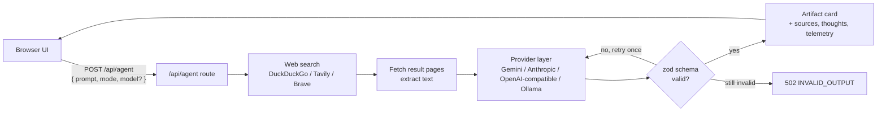

# Architecture

Nova is a single Next.js 16 (App Router) app. The server routes do the searching and LLM calls, and the browser renders the result as a card.

## Request flow

```
UI -> POST /api/agent -> search -> fetch pages -> LLM via provider layer -> zod validation (one retry) -> artifact card
```



1. **UI** sends `{ prompt, mode, model?, attachments?, context? }`. `model` is a `provider:model` id. If it's omitted, the server uses the first available default.
2. **Search** goes to Tavily or Brave when a key is set and falls back to DuckDuckGo HTML otherwise.
3. **Fetch** downloads the top result pages and extracts readable text to use as sources.
4. **LLM** is called through `src/lib/providers`, which hides the differences between vendors behind one `LLMProvider` interface.
5. **Validation** parses the model's JSON against the zod schema for the requested card type. If it fails, the model gets one retry. If it still fails, the request returns `INVALID_OUTPUT`.
6. **Response** contains `content`, an optional `artifact`, the `thoughts` (the steps that actually ran), the `provider`, and `telemetry` (measured latency, plus token counts when the provider reports them).

Errors use `{ error, code }`: `NO_PROVIDER` (503), `PROVIDER_ERROR` (502), `INVALID_OUTPUT` (502), and `BAD_REQUEST` (400). Error messages never include API keys or request URLs.

`/api/v1/models` and `/api/v1/chat/completions` provide an OpenAI-style API on top of the same provider layer.

## Folder map

| Path                | Contents                                                                                                                                   |
| ------------------- | ------------------------------------------------------------------------------------------------------------------------------------------ |
| `src/app/api`       | Route handlers: `agent` (main research endpoint), `v1/models`, `v1/chat/completions`                                                       |
| `src/lib/providers` | LLM provider layer: `types.ts` (the `LLMProvider` interface), one file per provider, and `index.ts` (registry, `resolveModel`, `generate`) |
| `src/lib/research`  | Web search providers, page fetching and text extraction                                                                                    |
| `src/lib/schemas`   | zod schemas for each card type and the validation/retry logic                                                                              |
| `src/components`    | React UI, including the card renderers in `GenerativeCards/`                                                                               |

## Principle: no fake data

Nothing shown to the user is invented to look real:

- Cards are built only from validated LLM output and sources that were actually fetched.
- `thoughts` list only steps that actually happened, such as "Found 6 results via DuckDuckGo".
- Telemetry is measured. If a provider doesn't report token usage, Nova reports `0`. It never estimates.
- When no provider is configured, Nova says so. There's no offline simulation or canned fallback answer.
