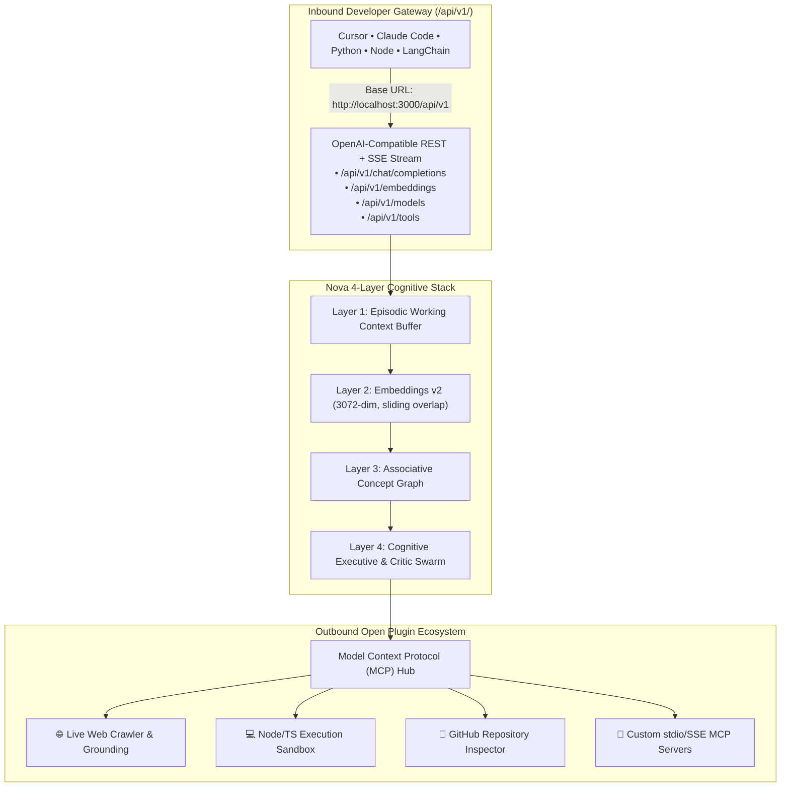

# Nova: The Universal Open-Source Autonomous Intelligence Studio

[](https://opensource.org/licenses/MIT)
[-black)](https://nextjs.org/)
[](https://modelcontextprotocol.io)
[](https://github.com/nova-autonomous/nova)
[-emerald)](https://github.com/nova-autonomous/nova)

**Nova** is a next-generation, local-first Autonomous Intelligence Studio built for everyone. While legacy chatbots trap you in passive walls of text, Nova orchestrates specialized multi-agent teams that **plan, research, synthesize, and render live interactive visual artifacts** (evidence graphs, milestone task DAGs, dynamic data charts, and weighted decision matrices).

Nova is equipped with **Embeddings v2 (3072-dimensional dense vector space with sliding chunk overlap)**, a native **Model Context Protocol (MCP) Plugin Hub**, and an **OpenAI-compatible Open Developer Gateway (`/api/v1/*`)** allowing any tool (Cursor, Windsurf, Claude Code, Python SDK, LangChain) to use Nova as a drop-in intelligence backend.

---

## 🌟 Core Pillars & Market Differentiation



### 1. 🔌 Model Context Protocol (MCP) Plugin Hub
- Standard, vendor-neutral tool calling based on Anthropic & open community specifications.
- **Built-in First-Party Plugins**:
  - `web_search`: Live search with verified academic & documentation citations.
  - `execute_code`: Isolated client-side JavaScript/TypeScript code runner with stdout capture.
  - `vector_semantic_search`: Real-time cosine similarity search over 3072-dim Embeddings v2.
  - `query_associative_graph`: Concept relationship discovery across Layer 3 memory nodes.
  - `inspect_github_repo`: Live open-source repository inspector (stars, issues, releases).
- **Custom MCP Connector**: Connect any external stdio or HTTP/SSE MCP server with a single click.

### 2. ⚡ OpenAI-Compatible Developer Gateway (`/api/v1/*`)
Point existing AI tools, IDEs, and codebases directly to Nova without modifying your code:
- `POST /api/v1/chat/completions`: Full multi-model streaming (`text/event-stream` SSE) with thinking traces.
- `POST /api/v1/embeddings`: 3072-dimensional dense vectors powered by `gemini-embedding-2`.
- `GET /api/v1/models`: Standard model enumeration (`gemini-3-flash-preview`, `claude-3-7-sonnet`, `deepseek-r1`, `ollama-local`).
- `GET /api/v1/tools` & `POST /api/v1/tools`: Dynamic MCP tool listing and safe execution.

#### 1-Line Drop-in Python Example:
```python
from openai import OpenAI

# Connect any Python script or agent directly to Nova!
client = OpenAI(
    base_url="http://localhost:3000/api/v1",
    api_key="nova-local-key"
)

response = client.chat.completions.create(
    model="gemini-3-flash-preview",
    messages=[{"role": "user", "content": "Analyze agent harness architecture"}]
)
print(response.choices[0].message.content)
```

### 3. 🧠 Embeddings v2 & 4-Layer Cognitive Intelligence
- **Sliding Chunk Overlap**: Splits documents across boundary windows (`windowSize=180`, `overlap=40`), preserving semantic continuity.
- **Layered Memory**:
  - *Layer 1 (Working Context)*: Active session messages & token sliding cache.
  - *Layer 2 (Dense Vector Space)*: High-dimensional geometric cosine similarity.
  - *Layer 3 (Associative Graph)*: Concept clustering and cross-reference topology.
  - *Layer 4 (Cognitive Executive)*: 4-agent swarm reflection with anti-hallucination verification.

---

## 🚀 Quick Start (Running in 30 Seconds)

### Prerequisites
- Node.js 20+ or Bun 1.2+

### 1. Clone & Install
```bash
git clone git@github.com:nova-autonomous/nova.git
cd nova
bun install # or: pnpm install
```

### 2. Configure Environment (Optional)
Nova runs completely offline with realistic fallback simulations. To enable live frontier models, configure `.env.local`:
```bash
cp .env.example .env.local
```
Add your key:
```env
GEMINI_API_KEY=your_gemini_api_key_here
```

### 3. Run Development Server
```bash
bun dev # or: pnpm dev
```
Open **[http://localhost:3000](http://localhost:3000)** in your browser.

### 4. Run Automated Test Suite
```bash
bun test
```
*Passes 23/23 tests across 5 test suites with 0 failures.*

---

## 🏗️ Architecture

```
nova/
├── src/
│   ├── app/
│   │   ├── api/
│   │   │   ├── agent/route.ts            # Autonomous Swarm Orchestrator
│   │   │   ├── enhance/route.ts          # 1-Click Prompt Enhancer API
│   │   │   ├── intelligence/route.ts     # Cognitive Layers & Vector Search API
│   │   │   └── v1/
│   │   │       ├── chat/completions/route.ts # OpenAI-Compatible Chat Gateway (REST + SSE)
│   │   │       ├── embeddings/route.ts   # OpenAI-Compatible Embeddings v2 (3072-dim)
│   │   │       ├── models/route.ts       # OpenAI-Compatible Models Directory
│   │   │       └── tools/route.ts        # MCP Tools Registry & Execution API
│   │   ├── globals.css                   # Custom theme tokens & responsive styles
│   │   └── page.tsx                      # Studio Workspace root
│   ├── components/
│   │   ├── Navbar.tsx                    # Engine selector, models, and audio toggles
│   │   ├── Sidebar.tsx                   # Presets, modes, Dev Hub, and session history
│   │   ├── AgentCanvas.tsx               # Collaborative prompt canvas with Thinking Budget
│   │   ├── IntelligenceCanvas.tsx        # 4-layer cognitive architecture & vector sandbox
│   │   ├── PluginsAndApiHub.tsx          # MCP Plugin Manager & Open API Playground
│   │   ├── SettingsModal.tsx             # BYOM key configuration & comparison matrix
│   │   └── GenerativeCards/              # Interactive UI cards (Debate, Plan, Chart, Code)
│   └── lib/
│       ├── ai-gateway.ts                 # Multi-model gateway with fallback resilience
│       ├── embeddings-v2.ts              # Sliding chunk overlap & 3072-dim cosine similarity
│       ├── intelligence-layers.ts        # 4-layer cognitive stack implementation
│       ├── mcp-registry.ts               # Model Context Protocol plugin and tool registry
│       ├── sanitizer.ts                  # Security hardening & prompt injection guardrails
│       └── sound.ts                      # Web Audio API harmonic acoustic synthesizer
```

---

## 🤝 Contributing to Nova

We welcome contributions from everyone! Adding a new Model, MCP Tool, or Generative UI card takes less than 50 lines of code:
- Read our [CONTRIBUTING.md](CONTRIBUTING.md) guide.
- Check open issues or submit a feature request using our structured GitHub templates.
- Ensure all tests pass (`bun test`) before opening a PR.

---

## 📄 License

Distributed under the **Apache 2.0 / MIT License**. Free for personal, academic, and commercial use.
