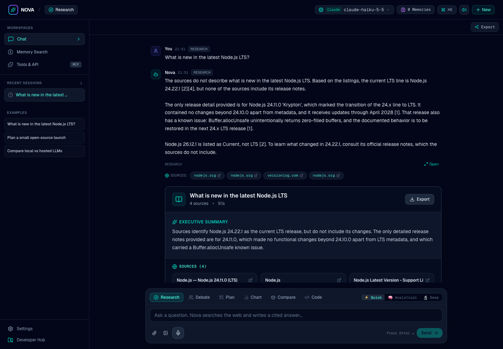

# Nova

You ask a question, Nova searches the web, and the LLM you choose (Gemini, Claude, OpenAI-compatible, or local Ollama) writes a cited answer rendered as interactive visual cards.



## Why Nova

- **Self-hosted.** It's a single Next.js app. You run it on your laptop or server, and your questions go only to the search provider and the LLM you configure.
- **Bring your own model.** Use your Gemini, Anthropic or OpenAI key, any OpenAI-compatible endpoint (OpenRouter, Groq, ...), or a local model through Ollama with no API key at all.
- **Answers as cited cards.** Instead of a plain wall of text, answers come back as cards: a research report with sources, a comparison matrix, a step-by-step plan, a chart, code, or a debate. Cards are built only from validated LLM output and the pages that were actually fetched.

Nova is early software. Expect rough edges, breaking changes, and features that are still being wired up.

## Quick start

Requires [Bun](https://bun.sh) 1.2+.

```bash
bun install
cp .env.example .env   # then set at least one provider (or run Ollama locally)
bun dev
```

Open http://localhost:3000. If no provider is configured, the UI shows setup instructions instead of answering.

### Docker

```bash
cp .env.example .env   # set at least one provider
docker compose up --build
```

To run a local model with no API key, use the bundled Ollama service:

```bash
# in .env: OLLAMA_BASE_URL=http://ollama:11434
docker compose --profile local up --build
docker compose exec ollama ollama pull llama3.2   # any model you like
```

For reliable web search with no API key, use the bundled [SearXNG](https://docs.searxng.org) service (config in `searxng/settings.yml`, JSON output enabled, bound to `127.0.0.1:8888`):

```bash
# in .env: SEARXNG_URL=http://searxng:8080
#          SEARXNG_SECRET=<output of `openssl rand -hex 32`>
docker compose --profile search up --build
```

Running Nova with `bun dev` instead? Start only SearXNG with `docker compose --profile search up -d searxng` and set `SEARXNG_URL=http://localhost:8888`. Profiles combine, e.g. `--profile local --profile search`.

## LLM providers

Configure one or more in `.env` (or `.env.local`, which takes precedence). Only configured providers show up in the model picker and in `/api/v1/models`. Model ids use the form `provider:model`, for example `anthropic:claude-sonnet-5-5`.

| Provider                   | Required                                                               | Optional                                                       |
| -------------------------- | ---------------------------------------------------------------------- | -------------------------------------------------------------- |
| Google Gemini              | `GEMINI_API_KEY` (or `GOOGLE_API_KEY`)                                 | `GEMINI_MODEL`                                                 |
| Anthropic Claude           | `ANTHROPIC_API_KEY`                                                    | `ANTHROPIC_MODEL` (default `claude-sonnet-5-5`)                |
| OpenAI / OpenAI-compatible | `OPENAI_API_KEY`                                                       | `OPENAI_BASE_URL` (for OpenRouter, Groq, etc.), `OPENAI_MODEL` |
| Ollama (local)             | Ollama running at `OLLAMA_BASE_URL` (default `http://localhost:11434`) | `OLLAMA_MODEL`                                                 |

Ollama only counts as configured when the server is reachable.

### Embeddings and memory search

Saved memories (Memory, ⌘J) live in your browser. **Memory Search** in the sidebar ranks them against a query:

- With an embeddings provider it embeds the memories and query and ranks by cosine similarity. Providers are tried in the order OpenAI, Gemini, Ollama. Anthropic has no embeddings API.
- Without one, or if the embeddings call fails, it falls back to keyword (BM25) search. The result always says which method was used, which embedding model was used, and why it fell back if it did.

| Provider                   | Embedding model (override) | Default                                                                                  |
| -------------------------- | -------------------------- | ---------------------------------------------------------------------------------------- |
| OpenAI / OpenAI-compatible | `OPENAI_EMBEDDING_MODEL`   | `text-embedding-3-small`                                                                 |
| Gemini                     | `GEMINI_EMBEDDING_MODEL`   | `gemini-embedding-001`                                                                   |
| Ollama                     | `OLLAMA_EMBEDDING_MODEL`   | first installed model whose name looks like an embedding model (e.g. `nomic-embed-text`) |

## Search providers

Providers are tried in this order; the first configured one that succeeds wins, and failures fall through to the next.

| Provider              | Setup                                                                                                                                                                    |
| --------------------- | ------------------------------------------------------------------------------------------------------------------------------------------------------------------------ |
| Tavily                | `TAVILY_API_KEY`                                                                                                                                                         |
| Exa                   | `EXA_API_KEY`                                                                                                                                                            |
| Brave Search          | `BRAVE_API_KEY`                                                                                                                                                          |
| SearXNG (self-hosted) | `SEARXNG_URL`. Recommended keyless option; see [Docker](#docker) for the bundled service. The instance must have `json` in `search.formats` (otherwise it answers `403`) |
| DuckDuckGo (HTML)     | No setup. Last-resort fallback; often blocks automated requests with a bot check, so configure one of the above for reliable search                                      |

## OpenAI-compatible API

Nova exposes a small OpenAI-style API, so you can point existing tools and SDKs at it.

- `GET /api/v1/models` lists the models of your configured providers (an empty `data` array when none are configured).
- `POST /api/v1/chat/completions` handles chat completions.
- `POST /api/v1/embeddings` returns embeddings from the first configured embeddings provider (or the `provider:model` you pass as `model`). It returns `503` when no embeddings provider is configured. `usage` is included only when the provider reports it (Gemini doesn't).

```bash
curl http://localhost:3000/api/v1/models

curl http://localhost:3000/api/v1/chat/completions \
  -H "Content-Type: application/json" \
  -d '{
    "model": "ollama:llama3.2",
    "messages": [{"role": "user", "content": "What is retrieval-augmented generation?"}]
  }'
```

The app UI itself uses `POST /api/agent`. See [ARCHITECTURE.md](ARCHITECTURE.md).

## Limitations

- No authentication. Don't expose an instance to the internet without putting it behind your own auth or proxy.
- Answer quality depends on the model you pick and on what the search provider returns. Small local models often fail schema validation more than hosted ones do.
- DuckDuckGo HTML search is unofficial and can be rate-limited or change without notice. Use SearXNG, Tavily, Exa, or Brave if you need it to be reliable.
- Some pages block fetching or need JavaScript, so their content can't be used as a source.
- Sessions and saved memories are stored only in your browser's localStorage. There's no server-side storage. Memories are sent with each question as context, and to the embeddings provider when you use Memory Search.

## Roadmap

- [x] Streaming answers in the UI
- [x] Source extraction, citation highlighting & dedicated Sources inspector
- [x] Saved and shareable research sessions (JSON backup/restore & Markdown export)
- [x] Local document attachment grounding (.txt, .md, .json, .csv, code files)
- [x] Interactive Provider & Health Control Hub with live latency tests & local engine presets
- [x] Desktop application readiness (Tauri v2)
- [x] Pluggable search providers (Tavily, Exa, Brave, SearXNG, DuckDuckGo)
- [ ] A hosted demo

Have an idea? Open an issue.

## Contributing

See [CONTRIBUTING.md](CONTRIBUTING.md). Security issues: see [SECURITY.md](SECURITY.md).

## License

MIT
